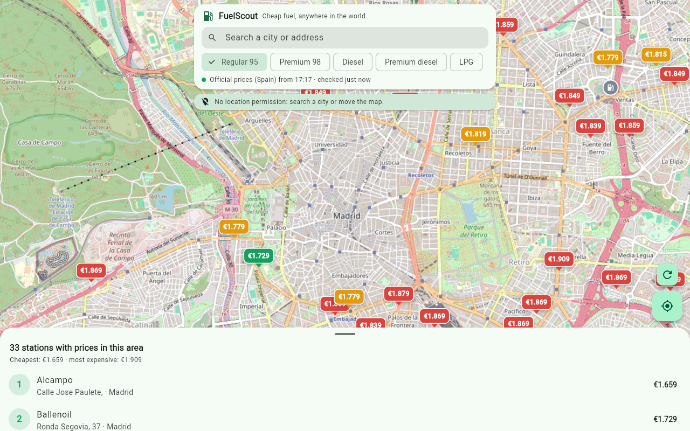
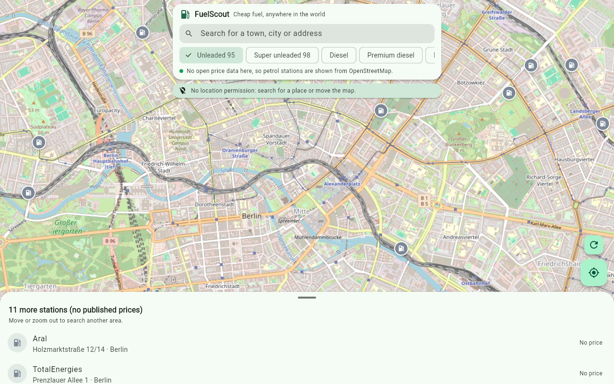

# FuelScout

**Encuentra la gasolinera más barata cerca de ti, en cualquier país.**
App en Flutter para Android y web. *Find the cheapest fuel near you, anywhere in the world.*

**Pruébala en el navegador:** https://rodrigoperez2803.github.io/fuelscout/
**APK para Android:** [última versión](https://github.com/RodrigoPerez2803/fuelscout/releases/latest)



## Qué hace

- Mapa con el precio de cada gasolinera, coloreado de más barata (verde) a más cara (rojo), y la lista de la zona ordenada por precio.
- Al mover el mapa se recalcula todo al instante. Los precios se vuelven a descargar cada 10 minutos y se marca qué gasolineras han subido o bajado.
- Ficha de cada gasolinera con todos sus precios, horario y botones para ir con Google Maps o Waze.
- Búsqueda de cualquier ciudad o dirección del mundo.
- Interfaz en español o inglés según el idioma del dispositivo, y precios en la moneda de cada país.

## De dónde salen los datos

| Zona | Fuente | Precios |
|---|---|---|
| España | Ministerio para la Transición Ecológica | Oficiales, en tiempo real |
| Francia | prix-carburants (data.economie.gouv.fr) | Oficiales, en tiempo real |
| Portugal | Direção-Geral de Energia e Geologia | Oficiales, en tiempo real |
| Resto del mundo | OpenStreetMap (Overpass API) | Gasolineras con marca, horario y combustibles, sin precio |

Cada fuente oficial se descarga solo cuando el mapa mira a su país. OpenStreetMap se consulta por celdas de 0,2° que se guardan en caché. Las gasolineras que aparecen en las dos fuentes se fusionan, y OpenStreetMap completa las marcas que faltan en los datos franceses.



## Arquitectura

```
lib/
  data/
    station.dart             Modelo común (combustibles, precios, moneda, país, fuente)
    price_sources.dart       Fuentes oficiales: España, Francia y Portugal (se procesan con compute)
    osm_source.dart          OpenStreetMap: Overpass por celdas y búsqueda con Nominatim
    station_repository.dart  Decide qué descargar según la zona visible
  ui/
    map_screen.dart          Mapa (flutter_map), barra superior, búsqueda y lista
    station_sheet.dart       Ficha de cada gasolinera
    strings.dart             Textos en español e inglés
```

## Desarrollo

```bash
flutter pub get
flutter test
flutter run                      # Android o Chrome
flutter build web --base-href /fuelscout/
flutter build apk --release
```

En la web se puede abrir en un sitio concreto: `?lat=48.8566&lng=2.3522&z=14`.

Mapa © colaboradores de OpenStreetMap. Datos de OpenStreetMap bajo licencia ODbL.
