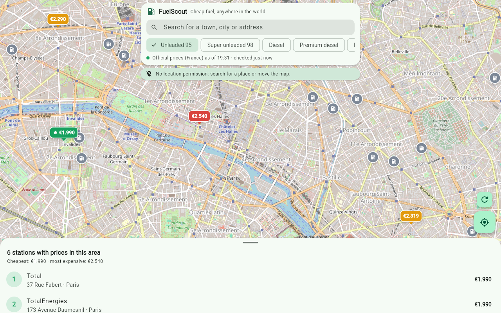

# FuelScout

**Find the cheapest petrol station near you, in any country.**
A Flutter app for Android and the web.

**Try it in your browser:** https://rodrigoperez2803.github.io/fuelscout/
**Android APK:** [latest release](https://github.com/RodrigoPerez2803/fuelscout/releases/latest)


## What it does

- A map showing each petrol station's price, colour-coded from cheapest (green) to most expensive (red), plus a list of the area sorted by price.
- Everything is recalculated instantly as you move the map. Prices are re-downloaded every 10 minutes, and stations whose prices have gone up or down are flagged.
- A detail sheet for each station with all its prices, opening hours and buttons to get directions in Google Maps or Waze.
- Search for any town, city or address in the world.
- The interface is in English or Spanish depending on the device language, and prices are shown in each country's currency.

## Where the data comes from

| Area | Source | Prices |
|---|---|---|
| Spain | Ministry for the Ecological Transition (MITECO) | Official, real time |
| France | prix-carburants (data.economie.gouv.fr) | Official, real time |
| Portugal | Directorate-General for Energy and Geology (DGEG) | Official, real time |
| Rest of the world | OpenStreetMap (Overpass API) | Stations with brand, opening hours and fuels, no prices |

Each official source is only downloaded when the map is looking at its country. OpenStreetMap is queried in 0.2° grid cells, which are cached. Stations that appear in both sources are merged, and OpenStreetMap fills in the brands missing from the French data.

| Paris: official prices and OpenStreetMap brands | Berlin: OpenStreetMap stations, no prices |
|---|---|
|  |  |

## Architecture

```
lib/
  data/
    station.dart             Shared model (fuels, prices, currency, country, source)
    price_sources.dart       Official sources: Spain, France and Portugal (parsed with compute)
    osm_source.dart          OpenStreetMap: Overpass by grid cell, and place search with Nominatim
    station_repository.dart  Decides what to download based on the visible area
  ui/
    map_screen.dart          Map (flutter_map), top bar, search and list
    station_sheet.dart       Station detail sheet
    strings.dart             English and Spanish UI text
```

## Highlights

- **Lazy, area-based loading:** each price source declares its coverage as bounding boxes, and the repository only fetches the sources that intersect the current view.
- **Off the UI thread:** the Spanish feed is around 12 MB of JSON, so all official feeds are parsed with `compute`.
- **Merging sources:** OpenStreetMap stations are matched to official ones on a ~120 m grid, so the same station isn't shown twice.
- **Resilience:** Overpass requests fall back to a second server; a failed price source is retried on the next map move after a 30-second back-off, or straight away with the retry button.
- **Unit tests** for each parser, using real (trimmed) API responses.

## Development

```bash
flutter pub get
flutter test
flutter run                      # Android or Chrome
flutter build web --base-href /fuelscout/
flutter build apk --release
```

On the web, the map can be opened at a specific place: `?lat=48.8566&lng=2.3522&z=14`.

Map © OpenStreetMap contributors. OpenStreetMap data is available under the ODbL licence.
